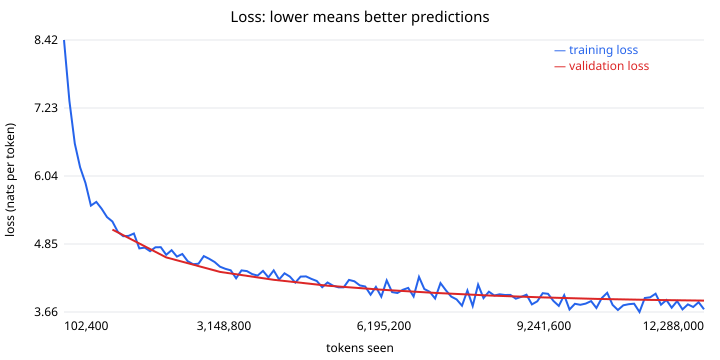

# CPU proof run (M3): report card

## In plain language

A language model with **3.3 million parameters** was trained from scratch on **12,288,000 tokens** of openly licensed text, in **31.2 minutes** on `cpu`.

- Before training, a model guessing at random would score a loss of about **9.01**.
- After training, its best score on text it never trained on was **3.86** (perplexity 48: roughly, it narrows each next-token guess down to about 48 likely options out of 8,192).
- **The falling line in the chart is the evidence that it learned.**

How well does it predict text? One honest yardstick is compression: a model that predicts text well can store it in fewer bits. On the whole validation text (224,185 bytes, never trained on):

| Method | Bits per byte (lower is better) |
|---|---|
| Random guessing, with our tokenizer | 3.67 |
| gzip (maximum compression) | 3.09 |
| xz (maximum compression) | 2.79 |
| **This model** | **1.57** |

Caveat: the compressors only see the validation text itself, while the model first learned from similar books, so this is a reference point, not a fair contest.

## What it can and cannot do (honestly)

It continues text in the style of what it read, word by word. It does not understand, reason, or know facts reliably, and it will make things up. It is a step that proves our tokenizer, model and training code work end to end; usefulness comes from larger models and from the cited library search (model option C).

## Sample text (AI-generated by this model; may be nonsense or wrong)

> **It was a bright morning, and** a very handsome young creature.
These are the only young man with whom we and the brothers will go,
of which kinds and bloom, or a man, the apt to be gone in
the house.  If one one can never do for an idea of a person

> **The best way to learn is** now here,
He is the dead, the darming and old,
And the sun is to me, now what is that you can be,
The spirit is not to be as the as much,
The sestabinating, the whole, the dirgier

> **She looked at the sea and said**, "I had no real place in the
doubted world.  I was not afraid of no doubt of my heart; that I
must be such things at least, and yet will be there so far
of the world that all shall be known.  I have never saw

## Cost

- Time: 31.2 minutes (0.52 hours)
- Energy: 0.0208 kWh, ESTIMATE assuming 40 W average draw (not measured)
- Device: `cpu`, precision torch.float32

## Details

- Stopped because: finished (step 3000 of 3000)
- Model: `{"vocab_size": 8192, "d_model": 192, "n_layers": 4, "n_heads": 3, "max_seq_len": 256, "ffn_multiple": 64, "dropout": 0.1, "rope_base": 10000.0}`
- Tokenizer fingerprint: `1ceb95c37c541ec0` (vocabulary 8,192)
- Data: 2,015,373 training tokens, 63,325 validation tokens
  - `nltk-gutenberg`: licences {'public-domain': 228}, kept/dropped {'kept': 228}
- Best validation: step 3000, loss 3.8637, perplexity 47.6, bits/byte 1.5735
